  

  
  
  

## Core Members

|  |  |
| :---: | :---: |
| **Đỗ Thành** | **ctdo** |
| `Core Member` | `Core Member` |
|   |  |

## Featured Project

| Repository | Stack & License | Metrics |
| :--- | :--- | :--- |
| <a href="https://github.com/ctdoteam1110/ctdozlite"><strong>ctdozlite</strong></a> Flagship open-source repository by ctdoteam1110 |   |   |

## Engineering & Workflow

| Domain | Standard | Link |
| :--- | :--- | :--- |
| **Permissions** | Role-based access & member governance | [People & Privileges](https://github.com/orgs/ctdoteam1110/people) |
| **Code Quality** | Pull Requests + Branch Protection on `main` | [Repository Settings](https://github.com/ctdoteam1110/.github/settings/branches) |
| **Automation** | Continuous Integration & Auto-assign Issues | [GitHub Actions](https://github.com/ctdoteam1110/.github/actions) |

 

  

